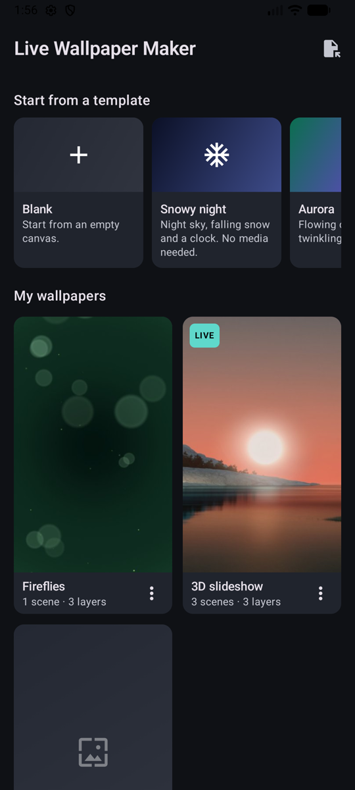
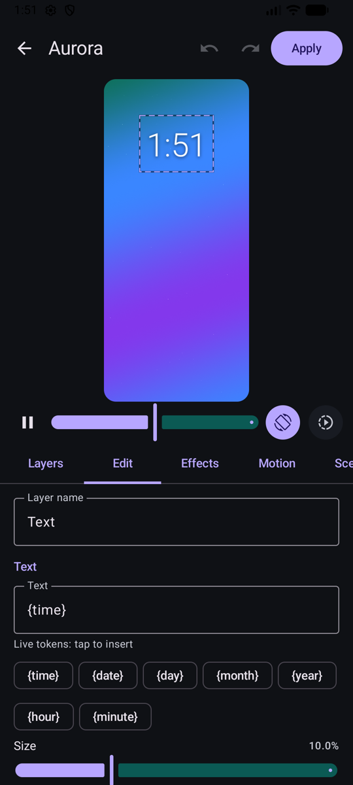
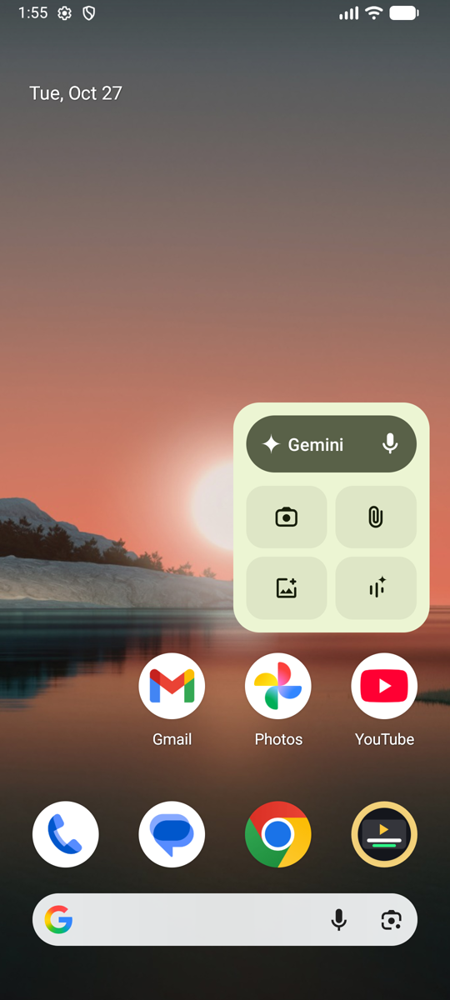
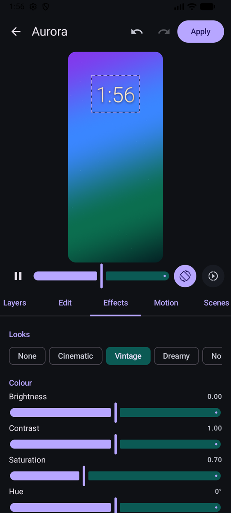
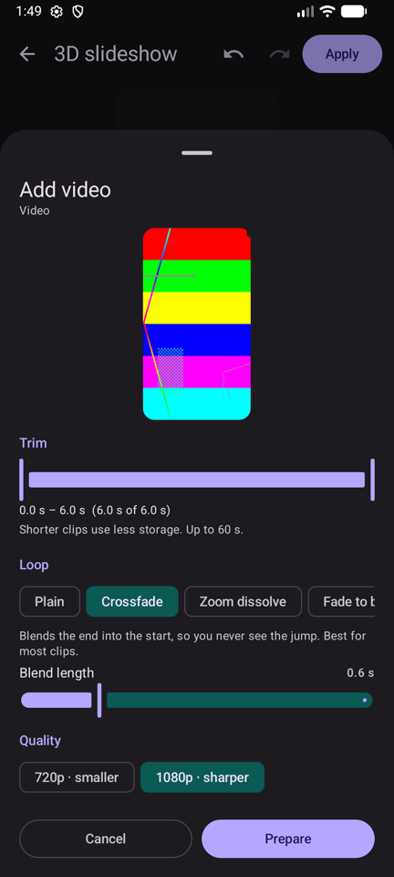
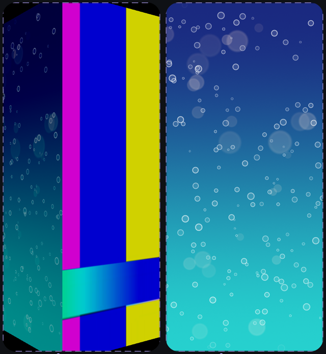
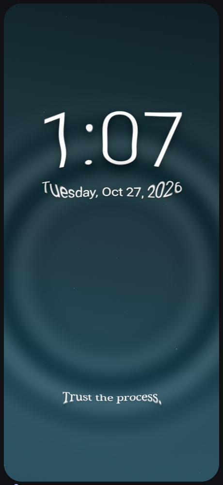
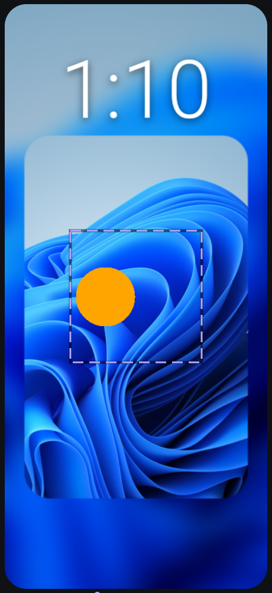
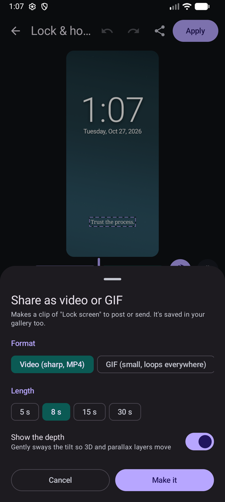

<p align="center">
  
</p>

<h1 align="center">Live Wallpaper Maker</h1>

<p align="center">
  <b>Make your own live wallpaper on Android.</b> Stack videos, GIFs, photos, gradients, particles and text,
  make them move when you tilt or swipe, and switch between scenes with 3D transitions.<br>
  Light on battery: the wallpaper only draws while you can see it.
</p>

<p align="center">
  <a href="https://github.com/R-Dilipkumar/live-wallpaper-maker-android/releases/latest"></a>
  <a href="LICENSE"></a>
  
  
  
</p>

<p align="center">
  
  
  
</p>

## Features

**New in 1.1:** one-tap 3D photos, tap effects, separate lock-screen and home-screen scenes, motion photos, animated stickers, shapes, your own fonts, colours that follow the day, and sharing your wallpaper as a video or GIF.

- **One-tap 3D photo.** Pick a photo with a person, pet or object in it: the app cuts it out on your phone, fills in the background behind it, and makes them float, with the clock tucked *behind* them. If a phone can't do the cut-out, it makes a floating 3D photo card instead.
- **Layers, like a design app.** Mix photos, videos, GIFs, gradients, particles (snow, rain, bokeh, stars, fireflies, bubbles) and text with a live clock or date. Drag, pinch and twist layers right in the preview.
- **Depth you can feel.** Give each layer its own **tilt** and **swipe** depth for a 3D parallax effect, using the phone's motion sensor and the home-screen pages.
- **Animation.** Ready-made moves (Ken Burns, float, pulse, sway, spin, breathe, drift) or your own **keyframes** for position, size, turn and opacity.
- **Looks and effects.** Brightness, contrast, saturation, hue, tint, blur, vignette, film grain, pixelate, colour split and wave, plus one-tap looks (Cinematic, Vintage, Dreamy, Noir, Glitch, Neon, and more).
- **Scenes and transitions.** Several scenes per wallpaper, with 13 transitions between them: crossfade, fade to colour, slide, push, zoom in/out, **3D flip**, **cube**, circle, wipe, dissolve and blur.
- **Scenes switch on their own:** on a timer, when you unlock, when you double-tap the home screen, by time of day (a day scene and a night scene), while charging, or when the battery is low. An **unlock intro** can play a short clip each time you unlock.
- **Lock screen and home screen can differ:** a big clock on the lock screen, calm colours at home.
- **Tap effects:** tap an empty spot on the home screen for a water ripple, sparkles or a glow.
- **Colours that follow the day:** warm mornings, golden evenings, cool blue nights.
- **Shapes:** cut any layer into a circle, rounded box, heart or star, or fade its edges.
- **Particles that fall with gravity** when you tilt the phone.
- **Motion photos come alive:** Pixel and Samsung motion photos become looping live layers.
- **Animated stickers:** transparent GIFs stay transparent and keep moving over your other layers.
- **Text extras:** outlines, your own font files, battery level, a new short quote each day, and countdowns to a date.
- **Seamless video loops.** Videos and GIFs are trimmed and turned into a loop when you add them: crossfade, zoom dissolve, fade to black or ping-pong, so the jump back to the start is invisible.
- **13 templates** to start from. Six of them (Snowy night, Lock & home, Aurora, Rainy evening, Fireflies, Blank) need no media at all.
- **Share your creations** as a video or GIF to post anywhere, or as a `.lwm` file that anyone with the app can open and edit.
- Undo/redo, autosave, Material You colours that follow your wallpaper, and no permissions. The APK is about 4 MB.

<p align="center">
  
  
  
</p>

<p align="center">
  
  
  
</p>

## Download

**[Download the latest APK](https://github.com/R-Dilipkumar/live-wallpaper-maker-android/releases/latest/download/live-wallpaper-maker-android.apk)**. Or see all [releases](https://github.com/R-Dilipkumar/live-wallpaper-maker-android/releases).

1. Download the APK on your phone.
2. Open it. If Android asks, allow installs from your browser or file manager.
3. Open **Live Wallpaper Maker**, pick a template, and tap **Apply**.

## How to use

1. **Pick a template** (or Blank). Templates with "media" slots show a **+** where your photo or video goes.
2. **Layers tab:** add photos, GIFs, videos, gradients, particles or text. Top of the list is the front.
3. **Edit / Effects / Motion tabs:** change the selected layer. You can also drag, pinch and twist it in the preview.
4. **Scenes tab:** add scenes, choose how each one comes in, and when they switch.
5. Use the controls under the preview: pause, the slider (acts like swiping home-screen pages), phone tilt, and **▶ Play as wallpaper** to try timers, intros, time of day, the lock screen and tap effects (tap the preview).
6. **Share** (top bar): make a video or GIF of the current scene.
7. Tap **Apply**. The first time, Android shows its wallpaper screen: tap **Set wallpaper**. After that, Apply updates the wallpaper straight away.

## How it works

- When you add a video or GIF, the app trims it, resizes it to fit your screen and bakes the loop transition into a short MP4, using the GPU and the phone's video encoder. The heavy work happens once, here.
- The wallpaper then plays those MP4s with the phone's hardware video decoder and draws every layer with OpenGL ES in a single pass, with effects included. It runs in its own small process (about 60–70 MB with two videos).
- **3D photos:** ML Kit finds the subject's outline on the phone; the gap behind it is filled from the surrounding colours, and the subject is placed on its own layer that moves more when you tilt.
- **Exports** draw the scene with the same code as the wallpaper, frame by frame, straight into the phone's video encoder (or a GIF with a shared colour palette and steady dithering, so it doesn't shimmer).
- It draws only while visible. A still scene draws one frame and then stops. When it's hidden or the screen is off, it uses no CPU, and after 30 seconds hidden it frees its video decoders. Battery Saver slows it down or pauses it (your choice), and it slows down if the phone gets hot.

## Good to know

- **Swipe parallax, double-tap and tap effects** depend on your launcher. Some launchers don't report home-screen swipes or taps.
- **Lock screen:** Android asks where to use the wallpaper. Whether a live wallpaper can show on the lock screen depends on your phone; lock-screen-only scenes need that.
- **3D photo cut-out** uses Google's on-phone ML Kit through Google Play services. The first time, it downloads a small model. Without Play services you get the floating 3D card instead.
- Keep to **2 videos per scene**. More can be too much for some phones' video decoders.
- Clips can be up to **60 seconds** (ping-pong up to 15 seconds). Videos play **without sound**.
- **Transparent GIFs** become animated stickers (up to 120 frames; longer ones keep every few frames at the same speed). Turn that off to use them as full-screen clips.
- **Exports** are saved to Movies (video) or Pictures (GIF) in a "Live Wallpaper Maker" folder.
- **HDR videos** are converted to normal colours. If a phone can't decode a video format at all, the app says so instead of failing silently.
- Scenes whose media slots are still empty are skipped by the wallpaper.

## Build from source

Needs Android Studio (or the Android SDK) and JDK 17.

```bash
git clone https://github.com/R-Dilipkumar/live-wallpaper-maker-android.git
cd live-wallpaper-maker-android
./gradlew installDebug
```

Tests: `./gradlew testDebugUnitTest` (JVM) and `./gradlew :engine:connectedDebugAndroidTest` (on a device or emulator: video baking, seamless loops, rotation, HDR fallback, rendering, transitions, intros).

Project layout:

- `engine/`: the wallpaper engine (OpenGL renderer, scene model, video/GIF/image sources, tilt sensor) and the clip baker. Only platform APIs plus a small JSON library.
- `app/`: the editor (Jetpack Compose), media import (incl. 3D photo cut-out with ML Kit), project storage and the `WallpaperService`.

Release builds are signed when a `keystore.properties` file is present (not in git). Without it they build unsigned.

## License

[MIT](LICENSE) © 2026 Dilipkumar R
